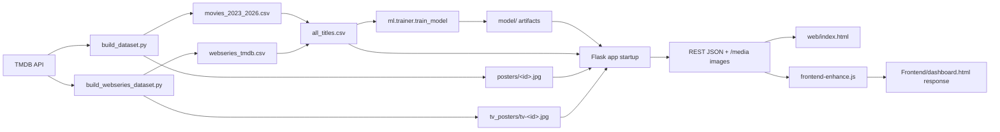

# Architecture

This document explains how MovieMate is put together, why each boundary exists, and where to change things. It complements the setup instructions in [`README.md`](../README.md) and the HTTP contract in [`API.md`](API.md).

## 1. System boundaries

MovieMate has four independently understandable parts plus supporting scripts:

| Part | Directory | Responsibility |
|---|---|---|
| Dataset builders | `Frontend/movie_dataset_builder/` | Original movie collector (untouched) plus new TV collector and combined-CSV merger |
| Shared ML core | `ml/` | Validation, cleaning, content IDs, feature construction, training, artifact I/O, retrieval; **no Flask imports** |
| API/application | `backend/` | Flask app factory, configuration, services, blueprints, validation, errors, static/media delivery, watch links |
| UI | `web/` plus preserved `Frontend/` | Original HTML/CSS/images enhanced only at response time; no generated SPA |
| Tooling | `training/`, `scripts/`, `tests/` | Train locally/Kaggle, bundle/install models, sync posters, automated tests |



The same `ml.trainer.train_model()` function is called by `training/train_local.py` and `training/train_kaggle.py`. Local and Kaggle runs therefore differ only in *where* input and output live, not in preprocessing or model logic.

## 2. Request lifecycle

1. `run.py` (development) or `wsgi.py` (production) calls `backend.app.create_app()`.
2. `create_app()` builds a `Config`, registers JSON error handlers, then creates five process-wide services:
   - `PosterService` — image resolution/caching for `<id>` and `tv-<id>` files.
   - `MovieRepository` — reads and cleans the combined CSV **once**, builds in-memory indexes and filter options.
   - `RecommendationService` — wraps the `RecommendationEngine` loaded by `load_model_state()` and applies session ranking.
   - `FeedbackService` — in-memory, cookie-keyed impression timers and Q-values for anonymous personalisation.
   - `WatchService` — cached, fail-soft TMDB/JustWatch provider and cinema-link lookups.
3. Services are stored on `app.extensions`; blueprints read them via `current_app.extensions`. No dataset or artifact is read during a request.
4. Each route validates query parameters (`backend/utils/validators.py`), calls a service, and returns the uniform envelope from `backend/utils/responses.py`.
5. Errors are converted by `register_error_handlers()` into JSON with a stable `error.code`; unexpected exceptions are logged server-side and never returned with stack traces or filesystem paths.
6. Flask serves only the original UI: `/`, `/frontend/*`, `/dashboard.html`, `/title/*`, `/admin*.html`, `/style.css`, `/script.js`, `/tvshow/*` and `/media/*`, plus `/js/ui-polish.js` and `/js/frontend-enhance.js`. `/app` is removed. One origin means no CORS configuration. Protected Frontend files are read and enhanced only in the HTTP response; the files on disk stay byte-for-byte unchanged.

Startup behaviour is controlled by `REQUIRE_MODEL_AT_STARTUP`:

- `true` (default, always in production): invalid/missing artifacts raise before the server accepts traffic.
- `false`: the app starts in **degraded** mode; `/api/health` reports `status: "degraded"` and recommendations return `503 MODEL_UNAVAILABLE`, while catalogue/search/filter endpoints continue to work.

## 3. Data contract and cleaning (`ml/preprocessing.py`)

`EXPECTED_COLUMNS` defines the 26 required columns; `OPTIONAL_COLUMNS` adds the combined-catalogue fields (content ID, media type, TV metadata), which are derived for movie-only CSVs. `clean_dataset()` is deterministic and follows three rules:

1. **No invented values.** Missing values become `None` or `""`; invalid ratings/counts/dates are discarded, never clamped or guessed.
2. **Canonical `content_id` is the primary key.** `ml/ids.py` maps numeric movie IDs to model key `"123"` / public ID `movie-123`, and TV IDs to model key `tv-123` / public ID `tv-123`. Non-integral or missing IDs are dropped with a count. Duplicate canonical IDs keep the most complete row; a movie and a series with the same numeric TMDB ID never collide.
3. **Text is normalised, not rewritten.** NFKC normalisation, whitespace collapsing, pipe-list trimming/deduplication; `split_list()` returns clean JSON arrays. `year` is recovered from a valid `release_date` when the year column is invalid, and vice versa. Ratings are kept only in 0–10; counts and runtime must be non-negative and finite. Remote image URLs are retained only when they are valid `http(s)` URLs on the allowlisted TMDB host.

`CleaningReport` counts every drop/repair and is embedded in `model_info.json` and the generated report so data quality is auditable.

## 4. Feature representation (`ml/config.py`, `ml/features.py`)

Six textual signals are used, in fixed order:

`title` (title + original title), `genres`, `overview`, `cast`, `director`, `original_language`.

Default weights: **genres 3, title 2, cast 2, director 2, original language 2, overview 1**.

A single `TfidfVectorizer` (1–2 grams, sublinear TF, Unicode accent stripping, `min_df=2`, `max_df=0.95`, max 200,000 terms, no internal normalisation) is fitted on the concatenation of all fields. For each field:

```
block_f = vectorizer.transform(texts_for_field_f) * weight_f
X       = L2_normalize(hstack(block_title, block_genres, ..., block_original_language))
```

Because every block is scaled and the stacked CSR matrix is row-normalised, a dot product of two rows is cosine similarity, and the configured weights genuinely change the geometry. The final combined run produced a **6,000 × 373,314** sparse matrix with **509,569** non-zero values (vocabulary 62,219 × 6 field blocks), about 13.4 MB of artifacts. The original 5,000-movie-only baseline was **5,000 × 320,022** with **423,465** non-zero values; both profiles are recorded in `reports/generated/evaluation_report.md`.

Hidden implementation detail with consequences: the vectorizer keeps per-field vocabularies but one shared feature space; therefore `len(vocabulary) * 6 == feature_dimensions`. Artifact validation enforces that identity.

## 5. Retrieval algorithm (`ml/inference.py`)

`RecommendationEngine.recommend(content_id, limit)`:

1. Look up the source record in `metadata` (keyed by model key); raise `UnknownMovieError` otherwise. Numeric IDs still resolve to movies for legacy callers.
2. Rebuild a one-row query vector from the stored per-field metadata using the **saved vectorizer and saved config**, so inference always matches training.
3. Compute `scores = X @ query.T` — a sparse-by-sparse multiplication returning a dense vector of length N. **No N×N similarity matrix is ever built.**
4. Set the query movie and any `exclude_ids` scores to `-inf`.
5. Sort deterministically with `np.lexsort` by `(score desc, popularity desc, canonical model key asc)`.
6. Walk the sorted list, dropping non-finite/non-positive scores and duplicate `(normalised title, year)` pairs, until `limit` results are collected.
7. Return `Recommendation` records with a score rounded to six decimals and a word-boundary-truncated overview (180 characters).

`limit` is validated: it must be an integer, is clamped to at least 1, and is capped by `config.max_top_k` (50 by default). `RecommendationService` maps engine exceptions to API errors: `MOVIE_NOT_IN_MODEL` (422) when the catalogue has the ID but the model does not, `MOVIE_NOT_FOUND` (404) otherwise.

`RecommendationService` asks the engine for a wider pool (`max(limit * 4, limit + 20)`, capped at `max_top_k`) before reranking. Without it, a temporal penalty could only reorder the same fixed top slice and repeated titles would still dominate.

## 5a. Session ranking (`backend/services/feedback_service.py`)

The cosine score remains the lead signal. On top of it:

1. Every selected title is stamped with the current time in an anonymous in-memory session keyed by the HttpOnly `mm_session` cookie.
2. On later requests its score is multiplied by `1 - min(0.9, strength * Σ 0.5^(age / half_life))`. Impressions older than the window are discarded, so the penalty is a fading timer rather than a permanent ban. Fresh candidates from the wider pool can rise into the result set.
3. `POST /api/feedback` maps `open`/`save`/`remove`/`dismiss` to bounded rewards (−1.0 to +1.0). An epsilon-greedy contextual bandit updates Q-values for the title and for its first three genres plus media type; a deterministic per-session jitter explores a small fraction of candidates. Ranking clamps the combined multiplier to `[0.45, 1.75]`.
4. `meta.personalization` reports the ranking mode and counts, never the session ID or Q-values. State is anonymous, bounded (`PERSONALIZATION_MAX_SESSIONS`), expires after `PERSONALIZATION_SESSION_MAX_AGE_SECONDS`, and disappears on restart.

## 6. Artifacts (`ml/artifacts.py`)

Six files are the only deployable model state:

| File | Contents |
|---|---|
| `tfidf_vectorizer.joblib` | Fitted shared vectorizer + IDF (joblib, compressed) |
| `movie_matrix.npz` | L2-normalised weighted CSR matrix (compressed `.npz`) |
| `movie_metadata.json` | Cleaned metadata keyed by model key (`"123"` / `"tv-123"`) |
| `movie_id_mapping.json` | `index_to_id` list + `id_to_index` object |
| `model_config.json` | Effective weights, TF-IDF settings, schema version, top-K policy |
| `model_info.json` | Real dataset stats, sizes, timing, library versions, evaluation note |

`load_artifacts()` validates completeness, schema version, types, finite matrix values, row counts, column count (`vocab × 6`), bidirectional ID mapping, and metadata key consistency **before** any request uses the model. `export_zip()` writes the six files at the ZIP root; `extract_model_zip()` accepts that layout or a `movie_model/` prefix, rejects absolute paths and `..` traversal, and only extracts the six known names.

Artifacts are text-derived. TMDB images are *not* part of the model and are resolved at request time.

## 7. Poster subsystem (`backend/services/poster_service.py`)

Resolution order for a movie:

1. First **valid** local file in `POSTER_DIRS` (ordered), matching `<content-key>.<ext>` — numeric for movies, `tv-<id>` for series — with ext in `jpg/jpeg/png/webp/gif` and valid image magic bytes, 64 B–12 MB.
2. Validated remote `poster_url` when `ALLOW_REMOTE_POSTERS=true` and the host is in `REMOTE_IMAGE_HOSTS`.
3. Committed fallback SVG (`/media/fallback/poster.svg`).

If `AUTO_DOWNLOAD_POSTERS=true`, a missing local poster is fetched once (with a timeout, content-type and magic-byte check, per-ID lock, atomic rename, and negative caching); the default is `false`, so downloads happen only via the explicit `scripts/sync_posters.py --download-missing` path.

Browsers never receive a filesystem path: local images are exposed as `/media/posters/<id>.jpg` or `/media/backdrops/<id>.jpg`. `media_path()` only accepts the strict `<digits>.<allowed-ext>` or `tv-<digits>.<allowed-ext>` patterns and re-validates the file, so arbitrary paths cannot be served. `/media/*` responses use conditional `ETag`/`Last-Modified` handling and `Cache-Control: max-age=` from `MEDIA_CACHE_MAX_AGE`. Resolution results are cached in-process for `POSTER_CACHE_TTL_SECONDS`.

This design reads the dataset builder's 4,958 existing posters directly instead of copying ~414 MB into the app.

## 7a. Watch/availability enrichment (`backend/services/watch_service.py`)

`GET /api/titles/<content_id>/watch?region=IN` calls TMDB `watch/providers` for movies or TV, plus `release_dates` for movies. Responses include real provider names, logos and deep links from TMDB/JustWatch. The TMDB bearer token is loaded server-side from the existing dataset builder's `.env`; it never reaches the browser or artifacts.

TMDB does **not** expose live cinema showtimes. The service therefore returns theatrical release metadata where available and clearly labelled ticketing searches (BookMyShow for `IN`, Fandango for `US`, Google showtimes everywhere). Network failures are caught, recorded in `errors`, and degraded to the dataset's real India provider snapshot when the region is `IN`; no providers are fabricated. Results are cached per `(content ID, region)` with a TTL and per-key locks.

## 8. API surface

Blueprints under `backend/routes/`:

| Blueprint | Routes |
|---|---|
| `health` | `GET /api/health` |
| `movies` | `GET /api/movies`, `GET /api/movies/<int:movie_id>` |
| `search` | `GET /api/search` |
| `recommendations` | `GET /api/recommendations/<int:movie_id>` |
| `filters` | `GET /api/filters`, `GET /api/trending` |
| `posters` | `GET /api/posters/<int:movie_id>`, `GET /media/<kind>/<filename>` |
| `titles` | `GET /api/series`, `GET /api/titles/<content_id>`, `/watch`, `/recommendations` |

All API responses use `{ success, data, meta, error }`. Validation rejects unknown query keys, out-of-range numbers, invalid choices, non-finite values, and control characters. See [`API.md`](API.md) for every parameter and payload shape.

## 9. Frontend design (`web/` and preserved `Frontend/`)

There is no generated single-page app or build step. `web/js/ui-polish.js` is injected into every served Frontend HTML response. It adds a skip link, visible `:focus-visible` rings, reduced-motion handling, semantic labels, responsive sign-in layout, 44 px minimum hit targets and 11 px minimum small text. These are response-time changes; the original files remain byte-for-byte unchanged.

`frontend-enhance.js` is injected only into `dashboard.html`. It maps static poster filenames to real content IDs, fills empty Movies/TV/Trending/Search/My List/Shuffle sections from the REST API, builds keyboard-accessible cards, and renders a labelled modal detail overlay with streaming/cinema links and personalised recommendations. A × control on suggested titles sends `dismiss` feedback; opening a title sends `open`; My List changes send `save`/`remove`. Loading states use `role="status"` and optional skeletons; focus is moved into the dialog on open and restored on close. Flask serves only safe asset extensions from `Frontend/`.

## 10. Extensibility points

- **Different weights or TF-IDF settings:** change `ModelConfig` / `--weights` / `--config`, retrain, reinstall artifacts; inference reads weights from `model_config.json`, so no code change is required in the API.
- **New field:** add it to `FEATURE_FIELDS`, `build_field_texts()`, and the cleaning contract; retrain. Artifact validation's column-count check will enforce the new block count.
- **Visual/embedding retrieval:** add a new artifact and weighted block in `ml/features.py`; keep posters as presentation-only until then. The public API shape can remain unchanged.
- **Ranking/feedback:** the current dataset has no relevance labels, so the bandit learns only from live anonymous interactions and never claims offline accuracy. Persisting sessions or adding explicit ratings would let `FeedbackService` grow into a fuller hybrid ranker without changing the cosine candidate stage.
- **New image source:** add directories to `POSTER_DIRS`/`REMOTE_IMAGE_HOSTS`; no code change.

## 11. Testing strategy

`tests/` (41 pytest cases) covers:

- schema validation, duplicate/invalid ID handling, list normalisation, invalid numeric/date values;
- per-field weighting, sparse shape, cosine scores, and training→artifact round trips;
- recommendation limits, exclusions, deterministic ordering, unknown IDs;
- poster validation, local/remote/fallback precedence, unsafe-path rejection;
- Flask endpoints via `app.test_client()`, including pagination, filters, search, 400/404/422 envelopes, and degraded model mode;
- a static check that frontend fetch paths are relative to `API_BASE` (prevents duplicated `/api/api/...` URLs);
- cache headers: frontend assets revalidate on deploy while `/media/*` stays cacheable;
- mixed movie/TV IDs, cross-media recommendations, generic title/watch routes, Frontend injection and safe asset denial;
- repeat-penalty rotation, timer expiry, bounded Q-value updates, session ID validation and feedback endpoint validation;
- response-time UI polish injection on every preserved page and the feedback path in the dashboard script.

`tests/conftest.py` builds a tiny synthetic dataset and trains a small artifact set in a temporary directory so tests never depend on the 5,000-row production dataset or network access. Run with `python -m pytest`.

## 12. Key invariants

1. Canonical `content_id` is the only primary key; `tmdb_id` is its source ID. Model keys are `"<id>"` for movies and `"tv-<id>"` for series.
2. Missing metadata stays missing; no fabricated values are written to artifacts or responses.
3. The saved vectorizer, weights, and ID mapping are the authoritative inference recipe.
4. No dense N×N matrix; retrieval is O(N) sparse work per query.
5. No filesystem path, secret, or stack trace is exposed by an endpoint.
6. Local and Kaggle training execute the same `ml/` code.
